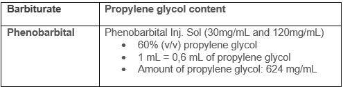

## Key points

- **We recommend to consult your poison centre with the use of this antidote.**
- Phenobarbital is contraindicated in patients with porphyria, hepatic impairment, and in patients known to be hypersensitive to barbiturates.
- After IV administration, the onset of action may be delayed for 5 to 15 minutes.
- In patients presenting with toxin-induced seizures and/or *status* [*epilepticus*]()  refractory to benzodiazepines, the administration of IV pyridoxine must be considered after consulting your poison center. &nbsp;
- The administration of IV phenytoin does not play a role in the management of toxin-induced seizures and/or toxin-induced *status epilepticus.*

## Synonyms and other terms

- Phenobarbital
- Phenobarbitone

## Indications

- Toxin-induced seizures and/or toxin-induced *status epilepticus* refractory to benzodiazepines; preferably in patients already intubated.

## Dosage

### Pediatric Dose

- **Loading dose :** 20 mg/kg infused IV over 20 minutes (maximal dose : 1000 mg). Maximum rate of infusion of 1 mg/kg/min (maximum rate : 30-50 mg/min).
- Depending on the evolution, a repeat dose of 5-10 mg/kg IV may be infused over 10 minutes every 20-30 minutes, if blood pressure can be maintained (maximal total initial dose: 40 mg/kg). Consultation with a neurologist and EEG monitoring is recommended with repeat dosing.
- Depending on the clinical presentation, the administration of maintenance doses may be required;. consult your poison centre.

### Adult Dose

- **Loading dose :** 20 mg/kg infused IV over 20 minutes; maximum rate of infusion 50 mg/min.
- Depending on the evolution, a repeat dose of 5-10 mg/kg IV may be infused over 10 minutes every 20-30 minutes, if blood pressure can be maintained (maximal total initial dose: 40 mg/kg). Consultation with a neurologist and EEG monitoring is recommended with repeat dosing.
- Depending on the clinical presentation, the administration of maintenance doses may be required; consult your poison centre.

### Renal Impairment

- Reduced maintenance doses are recommended in patients with renal impairment.

### Hepatic Impairment

- Reduced maintenance doses are recommended in patients with hepatic impairment.
- Phenobarbital is contraindicated in patients with liver [failure]() .

### Hemodialysis Patient

- Phenobarbital is dialyzable. Approximately 30% of the total body load will be eliminated during hemodialysis.
- Supplemental doses may be required depending on the renal replacement therapy used; consult your poison center.

### Pregnancy

- **Do not hesitate to use barbiturates in a pregnant patient if seizures or the expected poisoning outcome involves an important risk of morbidity or mortality. However, the risks associated with barbiturates are different when maintenance doses are required.**
- The use of phenobarbital for the treatment of epilepsy during pregnancy is associated with an increased risk of fetal malformations, intellectual deficit and neonatal coagulopathy. Its use during the third trimester may induce withdrawal in the newborn.
- No information to suggest the need to modify the dose with short term use.

### Obese or Overweight Patient

- In obese patients, the dose should be calculated with the ideal body weight in adults or the 95th percentile in children up to a maximum of 1000 mg/dose.

## Adverse effects

- Sedation and coma
- Respiratory depression and arrest
- Laryngospasm
- Bradycardia
- Hypotension
- Thrombophlebitis at the IV administration site
- Venous extravasation and cutaneous necrosis
- Stevens-Johnson Syndrome
- Propylene glycol (non-medicinal ingredient) associated toxicity
  - See table for phenobarbital propylene glycol content
  - Propylene glycol is a toxic alcohol, excessive exposure may result in CNS depression, hypotension, increased lactate, osmolar gap, anion gap, and acute kidney injury.&nbsp;
  - An exact toxic dose is not established but it appears that large amounts are required (e.g, more than 69g/day in a 70-kg person).
  - Risk factors for propylene glycol accumulation and toxicity include renal insufficiency and impaired alcohol dehydrogenase enzyme system (e.g. children, younger than 4 years of age, pregnant women, and patients with hepatic disease). 
    

## Monitoring

- Vital signs
- &nbsp;Signs and symptoms of venous extravasation
- Phenobarbital levels (depending on the clinical circumstances)
- Renal and liver [function]()&nbsp;

## End of treatment

- Resolution of seizures and/or *status epilepticus.*

## Special Notes on Administration

**Intravenous Route (IV)**

- **Slow IV infusion**
  - Preferred route of administration
  - Dilute the dose in 50 to 100 mL of a compatible solution.
  - Administer using a volumetric pump or syringe pump. Infuse slowly over 20 to 30 minutes. In adults the maximum rate is 50 mg/min and in children the maximum rate is 1 mg/kg/min (maximum rate : 30-50 mg/min).

**Intraosseous Route (IO)**

- Possible alternative to IV route.

**Intramuscular Route (IM)**

- Possible alternative to IV [route]() .
- IM administration must be in a large and deep muscle.
- &nbsp;A slower onset of action compared to IV administration should be anticipated.

**Subcutaneous Route (SC)**

- Not a recommended administration route.

**Enteral Route (PO ou TNG)**

- Not a recommended administration route for toxic emergencies..

**Compatibility**

Partial list only. Consult the pharmacist on duty at your health care facility.

- **Compatible solutions :** LR, NS, 1/2NS, D5W, and dextrose-saline combinations.
- **Y-site compatibilities :** sodium acetate, acyclovir, alfentanil, amikacin, aminocaproic acid, aminophylline, argatroban, asparaginase, atenolol, atropine, azathiporine, azithromycin, aztreonam, benztropine, sodium bicarbonate, bretylium, calcium (chloride and gluconate), cefazolin, ceftriaxone, chloramphenicol, clindamycin, cloxacillin, cyclophosphamide, daptomycin, dexamethasone, dexmedetomidine, digoxin, dopamine, enalaprilat, ertapenem, fentanyl, fluconazole, folic acid, fosphenytoin, furosemide, gentamicin, glycopyrrolate, heparin, hydrocortisone, insulin, ketorolac, labetalol, leucovorin, linezolid, lorazepam, magnesium sulfate, mannitol, meropenem, methotrexate, methylprednisolone, metoclopramide, metoprolol, metronidazole, milrinone, morphine, naloxone, nitroglycerin, nitroprusside sodium, octreotide, oxytocin, pancuronium, pentobarbital, phenylephrine, piperacillin-tazobactam, polymyxin B, potassium (acetate and chloride), procainamide, propofol, propranolol, ranitidine, rocuronium, streptokinase, streptomycin, sufentanil, theophylline, tigecycline, tobramycin, urokinase, vancomycin, vecuronium, voriconazole.
- **Y-site incompatibilities :** alemtuzumab, amiodarone, atracurium, buprenorphine, caspofungin, cefotaxime, cefotetan, cefoxitin, cefuroxime, chlorpromazine, cimetidine, codeine, cyclosporine, dantrolene, diazepam, diazoxide, diltiazem, diphenhydramine, dobutamine, epinephrine, esmolol,  , haloperidol, hydroxyzine, lansoprazole, meperidine, midazolam, minocycline, nicardipine, norepinephrine, ondansetron, papaverine, pentamidine, pentazocin, phenytoin, prochlorperazine, promethazine, protamine, pyridoxine, quinidine, sulfamethoxazole-trimethroprim, thiamine, verapamil.

**Stability**

- Store intact ampoules at room temperature (15-25°C), protect from freezing and protect from light..

## Available products

Phenobarbital sodium injectable USP, 30 mg/mL, Inj. Sol., 1 ml vials, Sandoz Canada Inc., DIN 02304082

Phenobarbital sodium injectable USP, 120 mg/mL, Inj. Sol, 1 ml vials, Sandoz Canada Inc., DIN 02304090

## Amount required to treat a person weighing 70kg during 24 hours

Minimum 2800 mg.

## References

Bauer LA. Phenobarbital/Primidone. In: Applied Clinical Pharmacokinetics, 3e. New York, NY: McGraw-Hill Medical; 2015.

Brickman K, Rega P, Choo M, Guinness M. Comparison of serum phenobarbital levels after single versus multiple attempts at intraosseous infusion. Ann Emerg Med. 1990 Jan;19(1):31–3.

Brickman KR, Rega P, Guinness M. A comparative study of intraosseous versus peripheral intravenous infusion of diazepam and phenobarbital in dogs. Ann Emerg Med. 1987 Oct;16(10):1141–4.

Brophy GM, Bell R, Claassen J, Alldredge B, Bleck TP, Glauser T, et al. Guidelines for the evaluation and management of status epilepticus. Neurocrit Care. 2012 Aug;17(1):3–23.

Glauser T, Shinnar S, Gloss D, Alldredge B, Arya R, Bainbridge J, et al. Evidence-Based Guideline: Treatment of Convulsive Status Epilepticus in Children and Adults: Report of the Guideline Committee of the American Epilepsy Society. Epilepsy Curr. 2016 Jan;16(1):48–61.&nbsp;

Hegenbarth MA, American Academy of Pediatrics Committee on Drugs. Preparing for pediatric emergencies: drugs to consider. Pediatrics. 2008 Feb;121(2):433–43.

Jaimovich DG, Shabino CL, Ringer TV, Peters GR. Comparison of intraosseous and intravenous routes of anticonvulsant administration in a porcine model. Ann Emerg Med. 1989 Aug;18(8):842–6.

Mactier R, Laliberté M, Mardini J, Ghannoum M, Lavergne V, Gosselin S, et al. Extracorporeal treatment for barbiturate poisoning: recommendations from the EXTRIP Workgroup. Am J Kidney Dis. 2014 Sep;64(3):347–58.

Rhoney DH, McALLEN KJ, LIU-DeRYKE XI, Jr. DP. Phenobarbital and Primidone. In: Cohen H, editor. Casebook in Clinical Pharmacokinetics and Drug Dosing. New York, NY: McGraw-Hill Education; 2015.

Wells BG, DiPiro JT, Schwinghammer TL, DiPiro CV. Status Epilepticus. In: Pharmacotherapy Quick Guide. New York, NY: McGraw-Hill Education; 2017.

Wilkes L, Danziger LH, Rodvold KA. Phenobarbital Pharmacokinetics in Obesity. Clin Pharmacokinet. 1992 Jun 1;22(6):481–4.

Tausif Zar et al, Recognition, Treatment, and Prevention of Propylene Glycol Toxicity,Seminars in Dialysis, 2007, 20(3), 217-219

 Ross et al. Toxic alcohol poisoning. Emergency Med Clin N Am 2022;40:327-34

 Lim et al. Propylene glycol toxicity in children. J Pediatry Pharmacy Ther 2014;19(4):277-282
