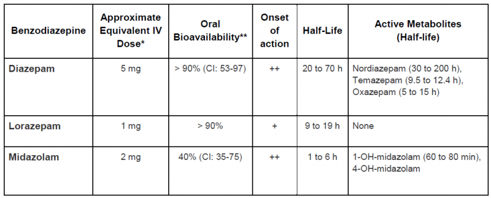
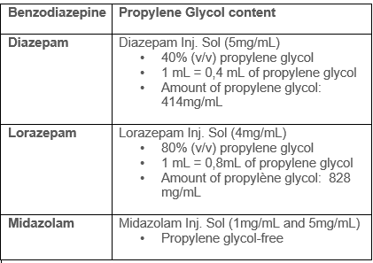

## Key points

- **We recommend to consult your poison centre with the use of this antidote.**
- There are three main benzodiazepines used in toxicology, diazepam, lorazepam and midazolam.
  - Given its very high lipid solubility, diazepam has a rapid onset of action.
  - Lorazepam has a slower onset of action, and is longer acting.
  - Midazolam's pharmacokinetic profile falls between the two.
- Agitation due to sympathomimetic drug poisoning (e.g., cocaine, amphetamines) is often associated with high blood pressure and once the agitation is controlled the hypertension generally resolves.
- Large amounts of benzodiazepines may be required, if so, the medical team should be ready to intubate the patient if needed.
- Note; there is no maximum total dose.

## Synonyms and other terms

- Diazepam
  - Diastat®
  - Diazemuls®
  - Valium®
- Lorazepam
  - Ativan®
- Midazolam
  - Versed®

## Indications

- Toxin-induced seizures
- Sympathomimetic toxidrome and agitation of toxic origin (e.g., cocaine, amphetamines)
- Treatment of serotonin toxicity or neuroleptic malignant syndrome
- Severe withdrawal from GABA agonists (e.g., alcohol, GHB, barbiturates, benzodiazepines)
- Chloroquine or hydroxychloroquine poisoning
  - Diazepam may be indicated; contact your local poison centre

## Dosage

**Equivalent Doses**

*\* Equivalent IV doses are approximations. Benzodiazepine drug conversions are based on published studies following oral use. Midazolam IV and lorazepam IV conversion were studied in mechanically ventilated patients on chronic treatment with the drug. The indication, frequency of use, drug interactions, comorbidities and age of the patient should also be considered.*

*\*\* The wide variation in oral bioavailability results in high inter-individual variability.*

*++ Very fast (1 to 5 minutes)*

*+ Fast (10 to 15 minutes)*

&nbsp;

&nbsp;

### Pediatric Dose

[Benzodiazepines\_Pediatric Dose.pdf](/sites/d8/files/Microsites/CAPQ/Antidotes/Benzodiazepines_Pediatric%20Dose.pdf)

### Adult Dose

[Benzodiazepines\_Adult Dose.pdf](/sites/d8/files/Microsites/CAPQ/Antidotes/Benzodiazepines_Adult%20Dose.pdf)

### Renal Impairment

- No data suggests that the dose should be modified for short-term use.&nbsp;
- However the active metabolite of midazolam can accumulate in patients with renal impairment. For lorazepam IV, there is a risk of propylene glycol toxicity with prolonged use.

### Hepatic Impairment

- No data suggests that the dose should be modified for short-term use.&nbsp;
- However, patients with hepatic impairment may be more sensitive to the effects of benzodiazepines.
- Benzodiazepines with a short or intermediate half-life and no active metabolite (e.g., lorazepam) should be the preferred choice.

### Hemodialysis Patient

No data suggests that the dose should be modified for short-term use.

### Pregnancy

- Do not hesitate to use benzodiazepine during pregnancy if the anticipated toxic effects pose a significant risk of morbidity or mortality.
- No data suggests that the dose should be modified for short-term use.
- Benzodiazepines with a short or intermediate half-life and no active metabolite (e.g., lorazepam) should be the preferred choice.

### Obese or Overweight Patient

No data suggests that the dose should be modified for short-term use.

## Adverse effects

- Sedation
- Coma
- Respiratory depression
- Respiratory arrest
- Paradoxal reactions have been described, particularly in children&nbsp;
  - A risk-benefit assessment is required
- Propylene glycol (non-medicinal ingredient) associated toxicity
  - See table for benzodiazepine propylene glycol content.
  - Propylene glycol is a toxic alcohol, excessive exposure may result in CNS depression,hypotension, increased lactate, osmolar gap, anion gap, and acute kidney injury.&nbsp;
  - An exact toxic dose is not established but it appears that large amounts are required (e.g, more than 69g/day in a 70-kg person).
  - Risk factors for propylene glycol accumulation and toxicity include renal insufficiency and impaired alcohol dehydrogenase enzyme system (e.g. children, younger than 4 years of age, pregnant women, and patients with hepatic disease).

## Monitoring

- Vital signs
- Adverse effects
- Doses used to treat chloroquine or hydroxychloroquine poisoning can produce respiratory depression. Patients will subsequently need to be intubated and appropriate ventilation measures taken.

## End of treatment

- Seizures: resolution of seizures.
- Agitation: anxiety/agitation managed.
- Hypertension: blood pressure within suitable range.
- Chloroquine or hydroxychloroquine poisoning: hemodynamically stable for 6 to 8 hours.
- Serotonergic toxicity or neuroleptic malignant syndrome: resolution of symptoms and return of normal vital signs for 12 hours.&nbsp;&nbsp;

## Special Notes on Administration

- According to protocol established by your health care facility.
- If needed, consult the pharmacist on duty at your health care facility.

## Available products

- Products generally kept in stock at all hospitals.

## Amount required to treat a person weighing 70kg during 24 hours

- At least 280 mg of injectable diazepam (or other equivalent benzodiazepines).

## References

Barr, Juliana, Gilles L. Fraser, Kathleen Puntillo, E. Wesley Ely, Céline Gélinas, Joseph F. Dasta, Judy E. Davidson, et al. 2013. “Clinical Practice Guidelines for the Management of Pain, Agitation, and Delirium in Adult Patients in the Intensive Care Unit.” *Critical Care Medicine* 41 (1):263–306. 
 
Boyer, Edward W., and Michael Shannon. 2005. “The Serotonin Syndrome.” *The New England Journal of Medicine* 352 (11):1112–20. 
 
Chen, Hsien-Yi, Timothy E. Albertson, and Kent R. Olson. 2016a. “Treatment of Drug-Induced Seizures.” *British Journal of Clinical Pharmacology* 81 (3):412–19. 
 
Hantson, Philippe E. 2016. “Toxin-Induced Seizures.” In *Critical Care Toxicology*, edited by Jeffrey Brent, Keith Burkhart, Paul Dargan, Benjamin Hatten, Bruno Megarbane, and Robert Palmer, 1–27. Cham: Springer International Publishing. 
 
Pileggi, Dominic J., and Aaron M. Cook. 2016. “Neuroleptic Malignant Syndrome.” *The Annals of Pharmacotherapy* 50 (11):973–81. 
 
Richards, John R., Dariush Garber, Erik G. Laurin, Timothy E. Albertson, Robert W. Derlet, Ezra A. Amsterdam, Kent R. Olson, Edward A. Ramoska, and Richard A. Lange. 2016. “Treatment of Cocaine Cardiovascular Toxicity: A Systematic Review.” *Clinical Toxicology* 54 (5):345–64. 
 
Sharma, Adhi N., and Robert J. Hoffman. 2011. “Toxin-Related Seizures.” *Emergency Medicine Clinics of North America* 29 (1):125–39. 
 
Vilke, Gary M., William P. Bozeman, Donald M. Dawes, Gerard Demers, and Michael P. Wilson. 2012. “Excited Delirium Syndrome (ExDS): Treatment Options and Considerations.” *Journal of Forensic and Legal Medicine* 19 (3):117–21. 
 
“White Paper Report on Excited Delirium Syndrome - ACEP Excited Delirium Task Force.” 2009. American College of Emergency Physicians.

Tausif Zar et al, Recognition, Treatment, and Prevention of Propylene Glycol Toxicity,Seminars in Dialysis, 2007, 20(3), 217-219 
&nbsp;

Ross et al. Toxic alcohol poisoning. Emergency Med Clin N Am 2022;40:327-34 
&nbsp;

Lim et al. Propylene glycol toxicity in children. J Pediatry Pharmacy Ther 2014;19(4):277-282

<!-- pied de page / footer -->

© Centre antipoison du Québec, CIUSSS de la Capitale-Nationale, 2017. The information contained in this site may be cited, provided the source is acknowledged. Any use for commercial or advertising purposes is strictly prohibited.
