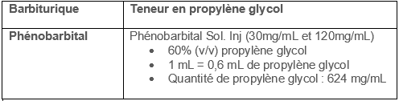

## Points clés

- **Nous recommandons de consulter votre centre antipoison lors de l’utilisation de cet antidote.**
- Les barbituriques sont contre-indiqués chez le patient atteint de porphyrie, de dysfonction hépatique sévère ou d’hypersensibilité aux barbituriques.
- Le délai d’action du phénobarbital par voie IV est de 5 à 15 minutes.
- Chez le patient qui présente des convulsions et/ou un *status epilepticus* d’origine toxicologique réfractaire aux benzodiazépines, l’administration de pyridoxine par voie IV devrait être envisagée après discussion avec votre centre antipoison.
- L’administration de phénytoïne par voie IV n’a pas de rôle dans le traitement des convulsions et/ou du *status epilepticus* d’origine toxicologique.

## Synonymes et autres appellations

- Phénobarbital
- Phénobarbitone

## Indications

- Convulsions et/ou *status epilepticus* d’origine toxicologique réfractaire aux benzodiazépines chez le patient préférablement intubé.

## Posologie

### Dose pédiatrique

- **Dose de charge :** 20 mg/kg en perfusion IV sur 20 minutes (dose maximale : 1000 mg). Vitesse d’administration maximale de 1 mg/kg/min (vitesse maximale : 30-50 mg/min).
- Selon l’évolution, on peut répéter aux 20-30 minutes avec une dose de 5-10 mg/kg en perfusion IV sur 10 minutes si la tension artérielle le permet (dose maximale totale initiale : 40 mg/kg). Dans de telles situations, une consultation en neurologie ainsi qu’un *monitoring* EEG sont à considérer.
- [Selon la clinique, il pourrait être nécessaire de poursuivre avec un traitement d’entretien. Dans de tels cas, il est recommandé de consulter votre centre antipoison.]()&nbsp;&nbsp;

### Dose adulte

- **Dose de charge :** 20 mg/kg en perfusion IV sur 20 min. Vitesse d’administration maximale de 50 mg/min.
- Selon l’évolution, on peut répéter aux 20-30 minutes avec une dose de 5-10 mg/kg en perfusion IV sur 10 minutes si la tension artérielle le permet (dose maximale totale initiale : 40 mg/kg). Dans de telles situations, une consultation en neurologie ainsi qu’un *monitoring* EEG sont à considérer.
- [Selon la clinique, il pourrait être nécessaire de poursuivre avec un traitement d’entretien. Dans de tels cas, il est recommandé de consulter votre centre antipoison.]()&nbsp;

### Insuffisance rénale

- Des doses d’entretien réduites sont recommandées chez les patients avec une fonction rénale altérée.

### Insuffisance hépatique

- Des doses d’entretien réduites sont recommandées chez les patients avec une fonction hépatique altérée.
- L’utilisation du phénobarbital est contre-indiquée chez les patients avec une dysfonction hépatique sévère.

### Patient hémodialysé

- Le phénobarbital est une substance dialysable. Environ 30% de la quantité corporelle totale serait éliminée par un traitement d’hémodialyse.
- Un supplément posologique pourrait être nécessaire suivant les thérapies de remplacement rénal. Veuillez consulter votre centre antipoison dans de tels cas.

### Grossesse

- **Il ne faut pas hésiter à utiliser les barbituriques pendant la grossesse si les effets attendus de l’intoxication ou des convulsions comportent un risque important de morbidité ou de mortalité. Les risques associés au traitement diffèrent cependant si un traitement d’entretien est requis.**
- L’utilisation de phénobarbital pour le traitement d’entretien de l’épilepsie durant la grossesse est associée à un risque accru de malformations fœtales, de retard intellectuel et de coagulopathie néonatale. Son utilisation durant le troisième trimestre peut provoquer un sevrage chez le nouveau-né.
- Aucune information ne suggère de modifier la dose pour un usage à court terme.

### Patient obèse ou avec un surplus de poids

- Pour les patients obèses, il est préférable d’établir la dose en utilisant le poids idéal chez l’adulte ou le 95e percentile pour les enfants, jusqu’à un maximum de 1000 mg/dose.

## Effets indésirables

- Sédation et coma
- Dépression et arrêt respiratoire
- Laryngospasme
- Bradycardie
- Hypotension
- Thrombophlébite au site d’administration IV
- Extravasation veineuse et nécrose cutanée
- Syndrome de Stevens-Johnson
- Toxicité associée au propylène glycol (excipient)
  - Voir le tableau pour connaître la teneur en propylène glycol de chaque benzodiazépine.
  - Le propylène glycol est un alcool toxique qui peut entraîner, lors d'une exposition à une quantité excessive, une dépression du SNC, de l’hypotension, une augmentation des lactates, du trou osmolaire et du trou anionique, ainsi qu’une insuffisance rénale aigüe.&nbsp;
  - Aucune dose toxique précise n'est établie, mais de grandes quantités sont nécessaires pour entraîner une toxicité (ex : plus de 69g/jour pour un patient de 70kg)
  - Les facteurs de risques d’accumulation et de toxicité du propylène glycol sont, l’insuffisance rénale et l’altération de l’enzyme alcool déshydrogénase (ex : enfant de moins de 4 ans, femmes enceintes et patients avec une atteinte hépatique)&nbsp;

## Surveillance clinique

- Signes vitaux
- Effets indésirables
- Signes et symptômes d’extravasation veineuse
- Concentration sérique de phénobarbital (selon le contexte clinique)
- Suivi du bilan hépatique et rénal

## Fin du traitement

- Arrêt des convulsions et/ou du *status epilepticus*

## Particularités reliées à l’administration

**Voie intraveineuse (IV)**

- Perfusion IV lente
  - Voie à privilégier
  - Diluer la dose dans 50 à 100 mL d’une solution compatible.
  - Perfuser lentement via pompe en 20 à 30 minutes à un débit maximal de 50 mg/min chez l’adulte et 1 mg/kg/min en pédiatrie (débit maximal : 30-50 mg/min).

**Voie intraosseuse (IO)**

- Alternative possible à la voie IV.

**Voie intramusculaire (IM)**

- Alternative possible à la voie IV.
- L’administration par voie intramusculaire devrait se faire dans un muscle large et profond.

**Voie sous-cutanée (SC)**

- Voie non recommandée.

**Voie entérale (PO ou TNG)**

- Voie non recommandée dans un contexte toxicologique.

**Compatibilité**

*Liste non-exhaustive, consultez le pharmacien de garde de votre établissement de santé.*

- **Solutés compatibles :** LR, NS, 1/2NS, D5E.
- **Compatibilités en dérivation-Y :** acétate de sodium, acyclovir, alfentanil, amikacine, acide aminocaproïque, aminophylline, argatroban, asparaginase, aténolol, atropine, azathiporine, azithromycine, aztréonam, benztropine, bicarbonate de sodium brétylium, calcium (chlorure et gluconate), céfazolin, ceftriaxone, chloramphénicol, clindamycine, cloxacilline, cyclophosphamide, daptomycine, dexaméthasone, dexmédétomidine, digoxine, dopamine, enalaprilat, ertapénem, fentanyl, fluconazole, acide folique, fosphénytoïne, furosémide, gentamicine, glycopyrrolate, héparine, hydrocortisone, insuline, kétorolac, labétalol, leucovorine, linézolide, lorazépam, sulfate de magnésium, mannitol, méropénem, méthotrexate, méthylprednisolone, métoclopramide, métoprolol, métronidazole, milrinone, morphine, naloxone, nitroglycérine, nitroprussiate, octréotide, oxytocine, pancuronium, pentobarbital, phényléphrine, pipéracilline-tazobactam, polymyxine B, potassium (acétate et chlorure), procaïnamide, propofol, propranolol, ranitidine, rocuronium, streptokinase, streptomycine, sufentanil, théophylline, tigécycline, tobramycine, urokinase, vancomycine, vécuronium, variconazole.
- **Incompatibilités en dérivation-Y :** alemtuzumab, amiodarone, atracurium, buprénorphine, caspofongine, céfotaxime, céfotétan, céfoxitine, céfuroxime, chlorpromazine, cimétidine, codéine, cyclosporine, dantrolène, diazépam, diazoxide, diltiazem, diphenhydramine, dobutamine, épinéphrine, esmolol, gentuzumab, halopéridol, hydroxyzine, lansoprazole, mépéridine, midazolam, minocycline, nicardipine, norépinéphrine, ondansétron, papavérine, pentamidine, pentazocine, phénytoïne, prochlorpérazine, prométhazine, protamine, pyridoxine, quinidine, sulfaméthoxazole-triméthroprim, thiamine, vérapamil.

**Stabilité**

- Conserver les fioles intactes à température ambiante (15-25°C), à l’abri de la lumière et du gel.

## Produits disponibles

Phénobarbital sodique injectable USP, 30 mg/mL, Sol. Inj., fioles de 1 ml, Sandoz Canada Inc., DIN 02304082

Phénobarbital sodique injectable USP, 120 mg/mL, Sol. Inj., fioles de 1 ml, Sandoz Canada Inc., DIN 02304090

## Quantité requise pour traiter un patient de 70 kg pendant 24 heures

Au moins 2800 mg.

## Références

Bauer LA. Phenobarbital/Primidone. In: Applied Clinical Pharmacokinetics, 3e. New York, NY: McGraw-Hill Medical; 2015.

Brickman K, Rega P, Choo M, Guinness M. Comparison of serum phenobarbital levels after single versus multiple attempts at intraosseous infusion. Ann Emerg Med. 1990 Jan;19(1):31–3.

Brickman KR, Rega P, Guinness M. A comparative study of intraosseous versus peripheral intravenous infusion of diazepam and phenobarbital in dogs. Ann Emerg Med. 1987 Oct;16(10):1141–4.

Brophy GM, Bell R, Claassen J, Alldredge B, Bleck TP, Glauser T, et al. Guidelines for the evaluation and management of status epilepticus. Neurocrit Care. 2012 Aug;17(1):3–23.

Glauser T, Shinnar S, Gloss D, Alldredge B, Arya R, Bainbridge J, et al. Evidence-Based Guideline: Treatment of Convulsive Status Epilepticus in Children and Adults: Report of the Guideline Committee of the American Epilepsy Society. Epilepsy Curr. 2016 Jan;16(1):48–61.&nbsp;

Hegenbarth MA, American Academy of Pediatrics Committee on Drugs. Preparing for pediatric emergencies: drugs to consider. Pediatrics. 2008 Feb;121(2):433–43.

Jaimovich DG, Shabino CL, Ringer TV, Peters GR. Comparison of intraosseous and intravenous routes of anticonvulsant administration in a porcine model. Ann Emerg Med. 1989 Aug;18(8):842–6.

Mactier R, Laliberté M, Mardini J, Ghannoum M, Lavergne V, Gosselin S, et al. Extracorporeal treatment for barbiturate poisoning: recommendations from the EXTRIP Workgroup. Am J Kidney Dis. 2014 Sep;64(3):347–58.

Rhoney DH, McALLEN KJ, LIU-DeRYKE XI, Jr. DP. Phenobarbital and Primidone. In: Cohen H, editor. Casebook in Clinical Pharmacokinetics and Drug Dosing. New York, NY: McGraw-Hill Education; 2015.

Wells BG, DiPiro JT, Schwinghammer TL, DiPiro CV. Status Epilepticus. In: Pharmacotherapy Quick Guide. New York, NY: McGraw-Hill Education; 2017.

Wilkes L, Danziger LH, Rodvold KA. Phenobarbital Pharmacokinetics in Obesity. Clin Pharmacokinet. 1992 Jun 1;22(6):481–4.

Tausif Zar et al, Recognition, Treatment, and Prevention of Propylene Glycol Toxicity,Seminars in Dialysis, 2007, 20(3), 217-219

 Ross et al. Toxic alcohol poisoning. Emergency Med Clin N Am 2022;40:327-34

 Lim et al. Propylene glycol toxicity in children. J Pediatry Pharmacy Ther 2014;19(4):277-282
