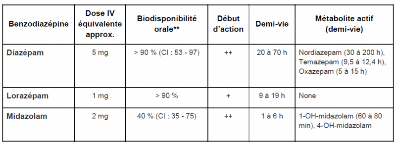
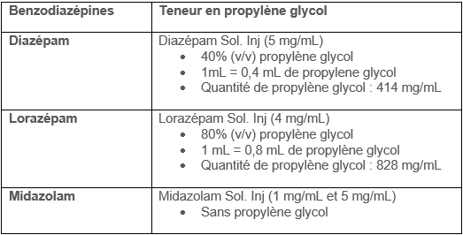

## Points clés

- **Nous recommandons de consulter votre centre antipoison lors de l'utilisation de cet antidote.**
- Les trois principales benzodiazépines utilisées dans un contexte toxicologique sont : diazépam, lorazépam, midazolam.
  - La grande liposolubilité du diazépam lui confère un début d’action très rapide.
  - Le lorazépam a un début d’action plus lent que le diazépam, mais une durée d’action plus longue.
  - Le midazolam se situe entre les deux.
- L’agitation lors d’intoxications par des substances sympathomimétiques (ex. : cocaïne, amphétamines) est souvent associée à l’hypertension artérielle. La maîtrise de l’agitation sera souvent associée à une normalisation de celle-ci.
- D’importantes quantités de benzodiazépines peuvent être nécessaires, si c'est le cas, l'équipe médicale devrait être prête à intuber le patient si nécessaire.
- À noter qu’il n’existe pas de dose totale maximale.

## Synonymes et autres appellations

- Diazepam
  - Diastat®
  - Diazemuls®
  - Valium®
- Lorazepam
  - Ativan®
- Midazolam
  - Versed®

## Indications

- Convulsions ou agitation d’origine toxique
- Hypertension provoquée par des substances sympathomimétiques (ex. : cocaïne, amphétamines)
- Traitement de la toxicité sérotoninergique ou du syndrome neuroleptique malin
- Sevrage sévère des agonistes GABA
- Intoxication par la chloroquine ou par l'hydroxychloroquine
  - Le diazépam pourrait être indiqué, contacter votre centre antipoison

## Posologie

**Doses équivalentes**

 
&nbsp;

*\* Les doses IV équivalentes sont des approximations. Les conversions de doses de benzodiazépines sont basées sur des études publiées suivant leur administration par voie orale. La conversion entre le midazolam IV et le lorazépam IV a été étudiée chez des patients ventilés mécaniquement recevant cette médication de façon chronique. Considérer également l’indication, la fréquence d’administration, les interactions médicamenteuses, les comorbidités et l’âge du patient.*

*\*\* Les écarts importants de la biodisponibilité orale représentent une importante variabilité interindividuelle.*

*++ Très rapide (1 à 5 minutes)*

*+ Rapide (10 à 15 minutes)*

&nbsp;

### Dose pédiatrique

[Tableau Benzodiazépines Doses Pédiatriques.pdf](/sites/d8/files/Microsites/CAPQ/Antidotes/Tableau%20Benzodiaz%C3%A9pines%20Doses%20P%C3%A9diatriques.pdf)

### Dose adulte

[Tableau Benzodiazépines Doses Adultes.pdf](/sites/d8/files/Microsites/CAPQ/Antidotes/Tableau%20Benzodiaz%C3%A9pines%20Doses%20Adultes.pdf)

### Insuffisance rénale

- Aucune information ne suggère de modifier la dose pour un usage à court terme.
- Cependant, le métabolite actif du midazolam peut s’accumuler en insuffisance rénale. Dans le cas du lorazépam IV, un risque de toxicité au propylène glycol existe lors d’usage prolongé.

### Insuffisance hépatique

- Aucune information ne suggère de modifier la dose pour un usage à court terme.
- Cependant, les patients insuffisants hépatiques peuvent être plus sensibles aux effets des benzodiazépines.
- Les benzodiazépines à demi-vie courte ou intermédiaire et qui n’ont pas de métabolite actif (ex. : lorazépam) devraient être préférées.

### Patient hémodialysé

Aucune information ne suggère de modifier la dose pour un usage à court terme.

### Grossesse

- Il ne faut pas hésiter à utiliser une benzodiazépine pendant la grossesse si les effets toxiques attendus comportent un risque important de morbidité ou de mortalité.
- Aucune information ne suggère de modifier la dose pour un usage à court terme.
- Les benzodiazépines à demi-vie courte ou intermédiaire et qui n’ont pas de métabolite actif (ex. : lorazépam) devraient être préférées.

### Patient obèse ou avec un surplus de poids

Aucune information ne suggère de modifier la dose pour un usage à court terme.

## Effets indésirables

- Sédation
- Coma
- Dépression respiratoire
- Arrêt respiratoire
- Réactions paradoxales décrites, particulièrement chez les enfants.
  - Une réévaluation risques-bénéfices est requise dans ce contexte.
- Toxicité associée au propylène glycol (excipient)
  - Voir le tableau pour connaître la teneur en propylène glycol de chaque benzodiazépine.
  - Le propylène glycol est un alcool toxique qui peut entraîner, lors d'une exposition à une quantité excessive, une dépression du SNC, de l’hypotension, une augmentation des lactates, du trou osmolaire et du trou anionique, ainsi qu’une insuffisance rénale aigüe.&nbsp;
  - Aucune dose toxique précise n'est établie, mais de grandes quantités sont nécessaires pour entraîner une toxicité (ex : plus de 69g/jour pour un patient de 70kg)
  - Les facteurs de risques d’accumulation et de toxicité du propylène glycol sont, l’insuffisance rénale et l’altération de l’enzyme alcool déshydrogénase (ex : enfant de moins de 4 ans, femmes enceintes et patients avec une atteinte hépatique)&nbsp;

 
&nbsp;

## Surveillance clinique

- Signes vitaux
- Effets indésirables
- Les doses utilisées dans le traitement d’une intoxication par la chloroquine ou par l’hydroxychloroquine pourront provoquer une dépression respiratoire. Le patient devra par conséquent être intubé et une ventilation adéquate être assurée.

## Fin du traitement

- Convulsions : arrêt des convulsions.
- Agitation : maîtrise de l’anxiété/l’agitation
- Hypertension : pression artérielle au niveau désiré.
- Intoxication par la chloroquine ou par l’hydroxychloroquine : état hémodynamique stable pendant 6 à 8 h.
- Toxicité sérotoninergique ou syndrome neuroleptique malin : disparition de la symptomatologie et retour à la normale des signes vitaux depuis 12 h.

## Particularités reliées à l’administration

- Selon les règles d’utilisation établies par votre établissement de santé.
- Au besoin, consultez votre pharmacien de garde.

## Produits disponibles

- Produits généralement en stock dans tous les hôpitaux.

## Quantité requise pour traiter un patient de 70 kg pendant 24 heures

- Au moins 280 mg de diazépam injectable (ou l’équivalent les autres benzodiazépines).

## Références

Barr, Juliana, Gilles L. Fraser, Kathleen Puntillo, E. Wesley Ely, Céline Gélinas, Joseph F. Dasta, Judy E. Davidson, et al. 2013. “Clinical Practice Guidelines for the Management of Pain, Agitation, and Delirium in Adult Patients in the Intensive Care Unit.” *Critical Care Medicine* 41 (1):263–306. 
 
Boyer, Edward W., and Michael Shannon. 2005. “The Serotonin Syndrome.” *The New England Journal of Medicine* 352 (11):1112–20. 
 
Chen, Hsien-Yi, Timothy E. Albertson, and Kent R. Olson. 2016a. “Treatment of Drug-Induced Seizures.” *British Journal of Clinical Pharmacology* 81 (3):412–19. 
 
Hantson, Philippe E. 2016. “Toxin-Induced Seizures.” In *Critical Care Toxicology*, edited by Jeffrey Brent, Keith Burkhart, Paul Dargan, Benjamin Hatten, Bruno Megarbane, and Robert Palmer, 1–27. Cham: Springer International Publishing. 
 
Pileggi, Dominic J., and Aaron M. Cook. 2016. “Neuroleptic Malignant Syndrome.” *The Annals of Pharmacotherapy* 50 (11):973–81. 
 
Richards, John R., Dariush Garber, Erik G. Laurin, Timothy E. Albertson, Robert W. Derlet, Ezra A. Amsterdam, Kent R. Olson, Edward A. Ramoska, and Richard A. Lange. 2016. “Treatment of Cocaine Cardiovascular Toxicity: A Systematic Review.” *Clinical Toxicology* 54 (5):345–64. 
 
Sharma, Adhi N., and Robert J. Hoffman. 2011. “Toxin-Related Seizures.” *Emergency Medicine Clinics of North America* 29 (1):125–39. 
 
Vilke, Gary M., William P. Bozeman, Donald M. Dawes, Gerard Demers, and Michael P. Wilson. 2012. “Excited Delirium Syndrome (ExDS): Treatment Options and Considerations.” *Journal of Forensic and Legal Medicine* 19 (3):117–21. 
 
“White Paper Report on Excited Delirium Syndrome - ACEP Excited Delirium Task Force.” 2009. American College of Emergency Physicians.

Tausif Zar et al, Recognition, Treatment, and Prevention of Propylene Glycol Toxicity,Seminars in Dialysis, 2007, 20(3), 217-219

 Ross et al. Toxic alcohol poisoning. Emergency Med Clin N Am 2022;40:327-34

 Lim et al. Propylene glycol toxicity in children. J Pediatry Pharmacy Ther 2014;19(4):277-282

<!-- pied de page / footer -->

© Centre antipoison du Québec, CIUSSS de la Capitale-Nationale, 2017. Les renseignements contenus dans ce site peuvent être cités, à condition d’en mentionner la source. Toute utilisation à des fins commerciales ou publicitaires est strictement interdite.

**ISSN : 2292-230X**

Auteurs: Bailey B, Blais R, Dubé PA, Friesen M, Gaudreault P, Gosselin S, Laliberté M, Larocque A, St-Onge M

Réviseurs: Elliott A, Mackenzie C, Murphy N, Letarte A, Pursell R, Thompson M, Yarema M
